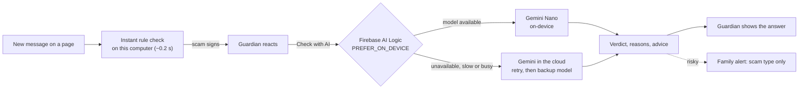

<div align="center">


# Family Scam Guard

**Know if a message is a scam before you reply. Checked on your device first.**

A Chrome extension and web app that protects families, especially elderly parents, from SMS, WhatsApp and email fraud.
Its robot **Guardian** watches the messages you read in real time and warns you the moment one looks like a scam.


Built for the **#BuildHybridAI 2026** hackathon · Platform: **Web (Chrome extension + web app)**

**[Demo video](#demo)** · **[How it works](#how-it-works)** · **[Run it locally](#run-it-locally)**

</div>

---

## The problem

Fake bank alerts, "you won a prize" texts and "Mum, I lost my phone" WhatsApp messages hit everyone, but older relatives lose the most. Checking a message with an online tool means sending a private conversation to someone else's server. And their children, who would spot the scam, usually hear about it too late.

## The solution

Family Scam Guard gives a clear verdict (**🚨 scam**, **⚠️ be careful** or **✅ looks safe**), the reasons, and one simple next step, in **English, French, Arabic or Nigerian Pidgin**.

- 🤖 **Guardian watches for you.** On any website (WhatsApp Web, Gmail, Facebook…), it reacts instantly when a new message shows scam signs and offers an AI check with one click.
- 🔒 **Private by design.** The AI runs on your device first. Message text is never uploaded or stored.
- 👪 **Family alerts.** When a parent gets a risky message, their children get an alert with the scam type, never the message itself.

## Demo

> 🎬 **Demo video:** _link coming soon_ · 🌐 **Live web app:** [family-scam-guard.web.app](https://family-scam-guard.web.app)

| Guardian state | What you see |
| --- | --- |
| 🟢 **Watching** | Guardian floats in the corner and blinks. Click it to see how many messages it has checked. |
| 🟡 **Be careful** | Amber eyes. The risky message gets a red outline and a list of red flags. |
| 🔵 **Checking** | Guardian scans the message with Firebase AI Logic, on your device first. |
| ✅ **Safe** | Green eyes and a happy hop, with the reasons it looks safe. |
| 🚨 **Scam** | Red eyes, a shake and a system notification, plus what to do next. |

## How it works



1. **Instant rules (free, local).** Red flags like pressure, requests for codes or money, shortened links and threats are detected in about 0.2 s. They drive Guardian's first reaction.
2. **Hybrid AI confirms.** Every AI check goes through **Firebase AI Logic** with `InferenceMode.PREFER_ON_DEVICE`: Gemini Nano in Chrome when available, Gemini in the cloud otherwise.
3. **The answer says where it ran.** Using `response.inferenceSource`, users see "🔒 Analyzed on your device" or "☁️ Analyzed in the cloud".

## How we used Firebase AI Logic

```js
// src/firebase.js
const ai = getAI(app, { backend: new GoogleAIBackend() }); // Gemini Developer API, no billing
const model = getGenerativeModel(ai, {
  mode: InferenceMode.PREFER_ON_DEVICE, // Gemini Nano first, cloud fallback
  inCloudParams: {
    model: cloudModel, // set from Remote Config
    generationConfig: { responseMimeType: 'application/json', temperature: 0.2 },
  },
});
```

What makes it robust in real life (`src/detector.js`):

- **On-device time limit:** slow computers can take 15 to 30 s. After 40 s, the same prompt automatically moves to the cloud.
- **Busy cloud:** one retry, then a backup Gemini model.
- **Tolerant parsing:** small on-device models sometimes return broken JSON, so a repair pass and a field extractor keep the answer usable.
- **Calibration:** the rules and the model check each other. Strong red flags never get a "safe" verdict, and weak on-device warnings with no red flags are softened.
- **Fast mode:** one tap skips the on-device model for a cloud answer in 2 to 5 s.

### Other Firebase services

| Service | Used for |
| --- | --- |
| **App Check** | Protects every AI call (reCAPTCHA Enterprise on the web, debug token for the extension) |
| **Remote Config** | Cloud model choice, prompt tuning and new scam rules (`scam_rules`) without a redeploy |
| **Cloud Firestore** | Family alerts, community scam-pattern feed and scan history, with offline cache |
| **Authentication** | Anonymous sign-in, so there's no account to create |
| **Performance Monitoring** | Timing traces comparing on-device and cloud checks |
| **Hosting** | The installable web app (PWA) |

## Features

- 🤖 **Guardian**: real-time page watcher with an animated robot and Chrome notifications
- ⚡ **Instant first answer** from local rules while the AI confirms
- ✅ **Real reasons for safe messages**, not just "looks safe"
- 🧠 **Remembers scammers**: links and phone numbers from confirmed scams are kept on the device and flagged if they return
- 🖱️ **Right-click any text** and choose "Check with Family Scam Guard"
- 🔊 **Read aloud** for people who struggle to read small text
- 🌍 **4 languages**: English, French, Arabic and Nigerian Pidgin
- 👪 **Family alerts** and a 🌐 **community feed** of scam patterns
- ♻️ **Result cache**: a message checked before answers instantly

## Privacy

| | |
| --- | --- |
| **Message text** | Never uploaded, never stored |
| **Guardian** | Reads pages only on your computer, with local rules |
| **AI check** | On your device first. The cloud is used only when on-device AI isn't available |
| **What Firestore stores** | Verdict, scam type and short reasons only |
| **Remembered scammers** | Links and numbers kept on your device only |

Chrome warns that the extension can "read and change all your data on all websites" because Guardian needs to see the messages on the page. The welcome page shown after install explains this in plain words.

## Run it locally

**Requirements:** Node.js 20+, a free Firebase project, desktop Chrome 139+ for on-device AI.

```bash
git clone <this-repository-url>
cd family-scam-guard
npm install
cp .env.example .env        # PowerShell: Copy-Item .env.example .env
npm run dev                 # http://localhost:5173
```

### Firebase setup (free, no billing)

1. Create a Firebase project and register a **Web app**. Copy its config into `.env`.
2. **AI Logic**: choose the **Gemini Developer API** and finish the guided setup.
3. **Authentication**: enable **Anonymous**.
4. **Firestore**: create a database and publish `firestore.rules`.
5. **App Check**: register the app, then under **Manage debug tokens** add the value you put in `VITE_APPCHECK_DEBUG_TOKEN`.
6. Optional **Remote Config** keys: `cloud_model`, `scam_prompt_extra`, `scam_rules`.
7. For on-device AI, enable `chrome://flags/#prompt-api-for-gemini-nano-multimodal-input` and restart Chrome.

### Chrome extension

```bash
npm run build:ext
```

Open `chrome://extensions`, turn on **Developer mode**, click **Load unpacked** and choose the `dist-ext/` folder. Then open WhatsApp Web and send yourself a test message:

> URGENT: your bank account will be blocked today. Send the OTP code we sent you to verify now.

### Hosted web app

```bash
npm run build
firebase deploy --only hosting
```

## Project structure

| Path | What it does |
| --- | --- |
| `src/firebase.js` | Firebase init, App Check, Remote Config, anonymous Auth, Firestore, hybrid model |
| `src/detector.js` | Prompt, tolerant parsing, on-device time limit, cloud retry and backup model, cache |
| `src/signals.js` | Instant red flags, reasons for safe messages, remembered scammers (shared with the extension) |
| `src/store.js` | Family alerts, community reports, scan history |
| `src/main.js` | Web app and extension popup UI |
| `extension/content.js` | Guardian: real-time page watcher and animated robot |
| `extension/background.js` | Right-click menu, AI check hand-off, notifications |
| `firestore.rules` | Security rules (no message text, ever) |

## What's next

- 📱 Android app with Gemini Nano, to protect SMS and WhatsApp on phones, where most scams arrive
- 🗺️ A shared map of scam numbers and links that gets smarter with every family
- 🗣️ More local languages and full voice mode for elderly users
- 📊 Measured catch and false-alarm rates on real scam messages

## License

[Apache-2.0](LICENSE)

<div align="center">
<sub>Not legal or financial advice. When in doubt, call the person or bank on a number you already trust.</sub>
</div>
